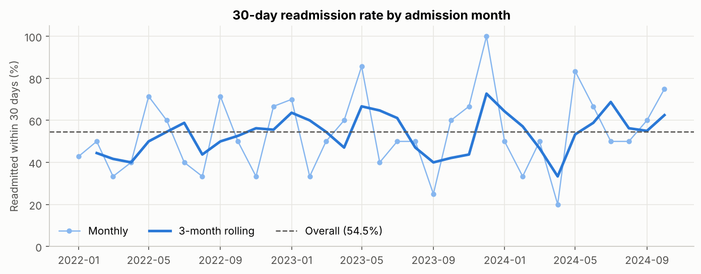
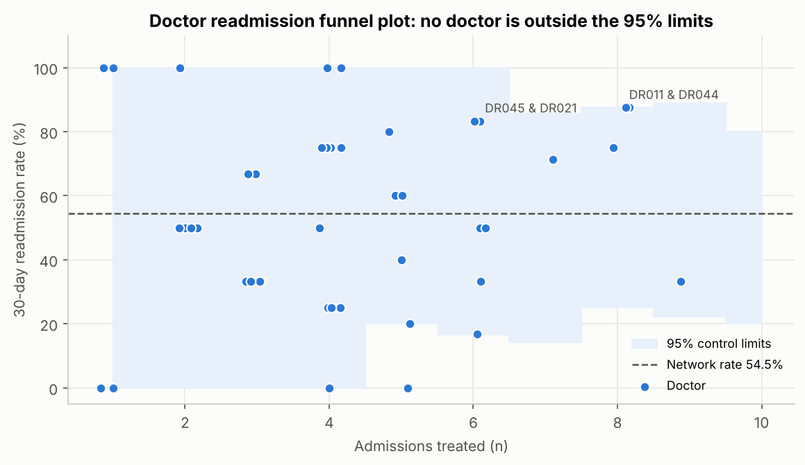

# Hospital Patient Outcomes Analytics

**TheBuidl Programme · Capstone Project 03 · Data Analyst track**
Python · SQL · Power BI · Excel

An outcomes intelligence platform for a network of 20 Nigerian hospitals. It covers patient flow, readmissions, mortality, cost and revenue collection, from raw admissions data to a clinical operations dashboard and a one-page executive brief.

---

## Analytical questions
1. What is the overall 30-day readmission rate?
2. Which diagnosis has the highest readmission rate, and why?
3. Does length of stay differ significantly between insurance types?
4. Which hospitals perform best and worst for patients?
5. What is the mortality rate by department, and where is the most room for improvement?
6. Are weekend admissions linked to discharge outcomes?
7. What does a patient day cost in ICU vs the general ward?
8. Which age group drives admissions, and with which diagnoses?
9. Are some doctors associated with higher readmission rates?
10. What should management do next?

## Key findings
| | |
|---|---|
| **30-day readmission** | **54.5%** (95% CI 47.6–61.3%), high across *every* group. Highest for malaria (66.7%), NHIS (65.4%), young adults (71.4%), but no group is statistically different (chi-square p = 0.78 for diagnosis). This points to a system-wide discharge problem. |
| **Mortality** | **22.5%** overall. Paediatrics highest at 35.0% (+5 excess deaths); HOSP004 41.2%. |
| **Left against advice** | **24.5%** of patients; **32.8%** of weekend admissions vs 20.6% on weekdays. |
| **Length of stay** | 23.2 days on average. Out-of-pocket patients stay about 6 days less than HMO/NHIS (median 15.5 vs 26 days; ANOVA p = 0.049, borderline). |
| **Cost** | ICU ₦20,529 per bed-day vs General ₦17,799 (+15%, not significant). LOS and bill are uncorrelated (r = −0.06). |
| **Revenue** | Only 66.2% of ₦85.3m billed was collected; ₦28.8m outstanding. |
| **Doctors** | No doctor is outside the 95% funnel limits; DR011 and DR044 (7 of 8 readmitted) are on the watch-list. |
| **Seniors** | 37.5% of admissions; top diagnoses HIV/AIDS, fracture, pneumonia. |

**Recommendations:** (1) fix ward coding, satisfaction capture and the readmission definition, and review Paediatric and HOSP004 deaths; (2) pilot a discharge-and-follow-up programme for NHIS and malaria/typhoid/diabetes patients; (3) reduce leaving-against-advice with weekend cover and cost counselling, and lift collections with pre-authorisation.
Full answers: [`docs/key_findings.md`](docs/key_findings.md) · Committee brief: [`docs/executive_brief.md`](docs/executive_brief.md)




## ⚠️ Data notes
The supplied file (`project3_hospital_patients.xlsx`) has **200 rows × 20 columns**, not the 3,000 × 30 in the brief. Column names differ and `satisfaction_score` is absent. Each difference is mapped and documented in [`docs/data_dictionary.md`](docs/data_dictionary.md). Ward labels also conflict with demographics (34 of 40 Paediatric patients are adults; 15 of 30 Maternity patients are male). Every figure is reported with its sample size, and department and doctor results are treated as signals to investigate, not verdicts. All code runs unchanged on the full dataset.

## Methodology
1. **Cleaning (Python):** parsed dates; recomputed and verified length of stay (no zero-day stays, so cost per day is safe); handled nulls (`secondary_diagnosis` → "No secondary"; *Died* rows kept as valid outcomes); relabelled outcomes to the brief's categories; ran clinical plausibility checks; checked completeness by facility.
2. **Feature engineering:** `age_group`, `cost_per_day`, `is_icu_admission`, `weekend_admission`, plus `bed_type`, `treatment_type` (proxy), `died`, `collection_rate`, `outstanding_ngn`, and month/quarter keys.
3. **SQL:** loaded the cleaned table into SQLite; wrote the 5 required queries plus completeness, weekend, age, trend and doctor-benchmark (subquery) queries; built `vw_hospital_outcomes_summary` (additive counts and sums, so any slice re-aggregates correctly).
4. **Exploratory and statistical analysis:** distributions, LOS–cost correlation, readmission by age group, mortality and readmission trends (3-month rolling), department × month heatmap, cost box plot. Tests: chi-square, ANOVA, Kruskal-Wallis, Mann-Whitney U, binomial tests, and a doctor funnel plot benchmarked against each doctor's own hospitals.
5. **Dashboard (Power BI):** 4 pages plus a hospital drill-through, with synced Hospital/Date/Diagnosis slicers. See [`powerbi/BUILD_GUIDE.md`](powerbi/BUILD_GUIDE.md).
6. **Scorecard (Excel/Google Sheets):** one-page hospital scorecard with live `AVERAGEIF`/`COUNTIFS`/`SUMIF` formulas; cells worse than the network average turn red.

All headline numbers reconcile across Python, SQL and Excel (e.g. HOSP008 readmission = 90.9% in all three).

## Repository structure
```
hospital-outcomes-analytics/
├── README.md
├── requirements.txt
├── data/
│   ├── project3_hospital_patients.xlsx   # raw file as supplied
│   ├── project3_hospital_outcomes.csv    # raw, CSV copy
│   ├── cleaned_admissions.csv            # output of notebook 01
│   ├── hospital_summary.csv              # per-hospital metrics (notebook 02)
│   ├── doctor_benchmark.csv              # doctor vs expected readmission (notebook 02)
│   └── hospital_outcomes.db              # SQLite database (load_to_sql.py)
├── sql/
│   ├── schema.sql
│   ├── queries.sql
│   └── views.sql                         # vw_hospital_outcomes_summary, vw_admissions_detail
├── python/
│   ├── 01_cleaning_and_eda.ipynb
│   ├── 02_outcomes_analysis.ipynb
│   ├── load_to_sql.py
│   └── build_scorecard.py
├── excel/
│   └── hospital_scorecard.xlsx
├── powerbi/
│   ├── BUILD_GUIDE.md
│   ├── measures.dax
│   ├── theme.json
│   └── clinical_dashboard.pbix           # built in Power BI Desktop
└── docs/
    ├── data_dictionary.md
    ├── key_findings.md
    ├── executive_brief.md
    ├── analysis_results.json
    └── images/
```

## How to run
```bash
pip install -r requirements.txt
cd python
jupyter nbconvert --to notebook --execute --inplace 01_cleaning_and_eda.ipynb   # clean + EDA
jupyter nbconvert --to notebook --execute --inplace 02_outcomes_analysis.ipynb  # answers + tests
cd ..
python python/load_to_sql.py        # builds data/hospital_outcomes.db with views
python python/build_scorecard.py    # rebuilds excel/hospital_scorecard.xlsx
```
Then open `data/hospital_outcomes.db` in DB Browser for SQLite or DBeaver and run `sql/queries.sql`.

## Author
Safaratu Mala Binga · Data Analyst
